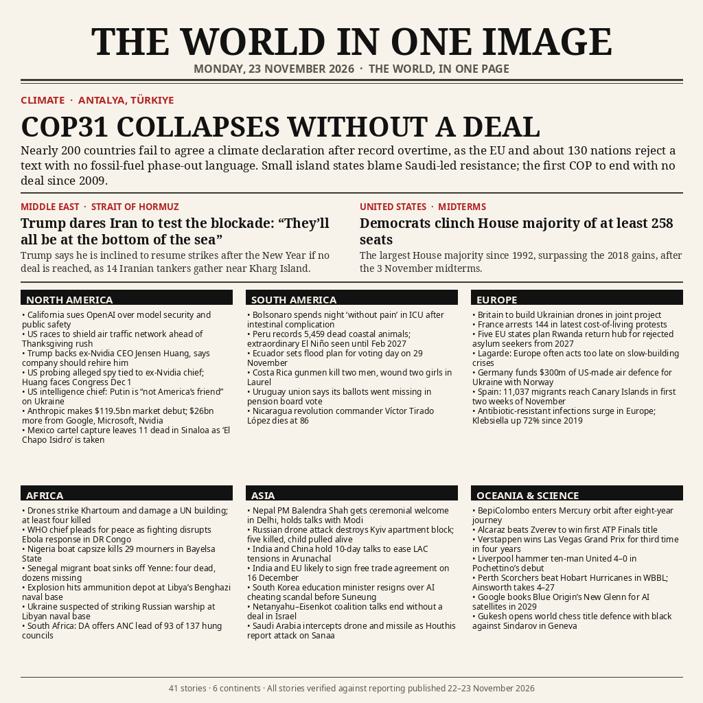

# nov23-world-news-image

[](https://make.fun/bounty/news-image-20261123?utm_source=github&utm_medium=readme&utm_campaign=news-image-20261123)
[](https://make.fun/bounty/news-image-20261123/leaderboard?utm_source=github&utm_medium=readme&utm_campaign=news-image-20261123)
[](https://make.fun/bounty/news-image-20261123?utm_source=github&utm_medium=readme&utm_campaign=news-image-20261123)

One image summing up Monday 23 November 2026's world news: a newspaper front page with **41 stories across 6 continents**, led by the COP31 climate summit collapsing without a deal in Antalya, the Trump–Iran Hormuz blockade standoff, and the Democrats clinching a 258-seat House majority. Every story was verified against reporting published 22–23 November 2026 (see `stories.json` for the full list and sources).



## Run it

```sh
python3 render.py
```

Regenerates `entry.png` (1024×1024) from `stories.json` with Python and Pillow — no network calls, no external assets, Noto fonts only.

## Files

- `entry.png` — the submitted image
- `stories.json` — the 41 verified stories, lead + second leads, grouped by continent
- `render.py` — the renderer that draws the front page

---

<sub>Entered on [make.fun](https://make.fun/bounty/news-image-20261123) as @thucthai7814.</sub>
